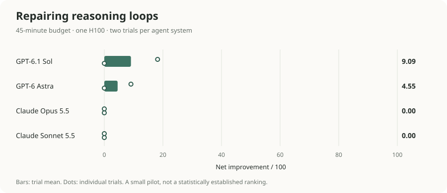

# Mechanistic Intervention Benchmark

Modern LLMs have shown that they can post-train models to improve scores on well-defined tasks. However, it remains unclear how well they can improve models through open-ended investigation of model behavior and targeted edits to model internals beyond conventional training. In our first task, agents receive model weights, development examples, an evaluator, and a fixed H100 time budget to address repetitive reasoning loops. They submit a small patch that scales selected attention or MLP components. Hidden evaluation rewards correct recovery on unseen failures and subtracts regressions on previously correct cases. Our initial pilot covers one model and one failure family, with two trials per agent system.

## How the benchmark works

**Budgeted agents repair real small-model failures through constrained internal interventions.** The first task, `stop-reasoning-loops`, asks an agent to make one fixed weight intervention that improves correct completion on unseen inputs, preserves already-correct behavior, and transfers beyond the development examples.

Each agent receives the original weights, six public development examples, their baseline outputs, a warmed evaluator, and up to 45 minutes on one H100. The submission is a JSON patch of at most 16 KiB. A separate, offline verifier reconstructs the patch on pristine weights and grades 17 hidden examples. The benchmark dataset is `mechanistic-intervention-benchmark`; `stop-reasoning-loops` is its current task.

The current model under repair is `robbiemu/MobileLLM-R1-950M-mlx-fp16`, pinned to revision `cdd21efc69cc89fa9608cfbad863f9eebb9dc9fb`. Despite its repository name, the checkpoint used here loads with Transformers/vLLM on CUDA. This model is the experimental substrate, not the agent being ranked.

### What the agent may change

The patch scales existing attention output projections or MLP down projections. It may target whole branches, individual attention heads, or individual MLP neurons. A gain of zero deletes a contribution, one preserves it, and a negative gain reverses its sign.

| Constraint | Limit |
| --- | ---: |
| Edit operations | 8 |
| Distinct layers | 4 of 22 |
| Whole-branch edits | 4 |
| Selected attention heads | 8 total |
| Selected MLP neurons | 128 total |
| Gain | −1 to 2 |

Overlapping edits are rejected. Agents may inspect activations, use gradients diagnostically, and search the allowed gains. Submitted executable code, arbitrary weight checkpoints, new parameters, prompt changes, altered decoding, and runtime hooks are not accepted. The verifier enforces the intervention through a small data-only language rather than trusting an agent's description of its method.

This tests whether constrained internal edits work. A high score does **not** establish that the agent identified a causal circuit or supplied a correct mechanistic explanation.

### Hidden evaluation and one primary score

| Cohort | Cases | Baseline behavior | Question |
| --- | ---: | --- | --- |
| Repair | 7 | Incorrect, repetitive nontermination | Does the intervention repair unseen failures? |
| Specificity | 6 | Correct completion | Does it preserve useful behavior? |
| Transfer | 4 | Incorrect, repetitive nontermination | Does the repair generalize to different content and tool situations? |

The cohorts were frozen using baseline measurements before these agent runs. Agents see the six development examples, not the hidden cases or their outputs.

```text
newly solved = correct repair cases + correct transfer cases
regressions  = 6 − correct specificity controls
score        = 100 × max(0, newly solved − regressions) / 11
```

Doing nothing earns **0**. Each recovered failure adds 9.09 points and each broken control subtracts 9.09 points, with a floor of zero. Retaining all controls earns no points on its own. Repair, specificity, transfer, and the regression count remain visible as diagnostics. Invalid submissions receive zero with an explicit invalid flag; infrastructure or baseline-calibration failures are not treated as measured zero scores. Valkyrie receives `reward = score / 100` and displays it on the 0–100 scale.

The fixed evaluator uses greedy decoding, a 1,024-token limit, BF16, vLLM 0.11.0, seed zero, and one input at a time. A correct final answer is required: merely shortening an output does not count. Budget exhaustion always fails. Tool requests require exactly one call with the expected name and arguments; direct text answers and final boxed arithmetic answers use their specified matchers.

The looping diagnostic requires all three: exhaustion of the token budget, a 12-word phrase repeated at least three times in the last 384 words, and at least 30% repeated five-grams in that tail. The verifier first reproduces the full calibrated baseline rows exactly, then evaluates the patch. Tool schemas go into the system message without the tokenizer template's mandatory-function-call preamble, avoiding the conflict found in an earlier pilot.

## What this pilot measures

This pilot evaluates whether an agent can investigate a small model's failures and turn that investigation into a constrained weight intervention that improves correct completion on unseen inputs while preserving existing capabilities. It tests experimental execution, intervention selection, and generalization under a fixed time and compute budget. The score measures the resulting repair; it does not grade the agent's mechanistic explanation.

Hidden evaluation distinguishes local gains from unseen repairs, and penalizes broken controls. Stopping repetition without producing a correct answer earns no credit. Preserving controls alone earns no points. These checks make the task meaningful even when development performance looks promising. Low scores alone are not evidence that an evaluation is good or appropriately calibrated.

### Limits on interpretation

- **Repair is not proof of mechanistic understanding.** Gain search or ablation can succeed without identifying a causal circuit. The current task does not independently validate explanations.
- **Coverage is narrow.** This pilot uses one target model, one failure family, six development examples, and 17 hidden cases selected using baseline behavior. It does not estimate performance across small models or naturally occurring failures in general.
- **Rankings are preliminary.** Two trials per system and eleven baseline failures produce coarse scores and substantial uncertainty. The observed differences do not establish a stable ranking.
- **Harness and strategy matter.** Codex and Claude Code differ, and agents may finish before the budget expires. Results compare complete agent systems under the offered budget, not isolated model ability or equal amounts of work.
- **The zero floor creates a risk incentive.** A damaging patch and an unchanged model can both score zero. One Opus trace explicitly used this floor to justify a risky submission. Regression diagnostics expose the difference, but do not remove the incentive.
- **Transfer remains unproven.** None of the initial eight completed submissions repaired a hidden transfer case. This is an observed outcome on four cases, not proof that constrained repair cannot generalize.

The supported claim is that this pilot tests whether agents can turn model investigation into constrained repairs that generalize while preserving existing behavior. It is a feasibility study of that capability, not a comprehensive mechanistic-interpretability benchmark.

## Results

**Eight completed trials, two per agent system, with a 45-minute maximum per trial.** These are the frozen `submission-45m` dataset runs with `bounded-net-improvement-v2` scoring. Ten-minute smoke tests and older versions are excluded. Inkling-2-Small's two attempted comparable trials failed before grading because the agent exceeded the model's context window. They have no benchmark scores and are excluded from averages.



| Agent model | Harness | Trial 1 | Trial 2 | Mean / 100 | Actual agent time, trials 1 / 2 |
| --- | --- | ---: | ---: | ---: | --- |
| GPT-6.1 Sol | Codex | 18.18 | 0.00 | **9.09** | 44m 07s / 43m 54s |
| GPT-6 Astra | Codex | 9.09 | 0.00 | **4.55** | 44m 40s / 43m 38s |
| Claude Opus 5.5 | Claude Code | 0.00 | 0.00 | **0.00** | 24m 41s / 10m 23s |
| Claude Sonnet 5.5 | Claude Code | 0.00 | 0.00 | **0.00** | 42m 52s / 34m 13s |
| Inkling-2-Small | Claude Code via Tinker | API failure | API failure | — | ~17m49s / ~22m09s before failure |

The time budget is a maximum, not a requirement to use every minute. Completed-trial times above are Valkyrie's `agent_run_duration`, rounded to the nearest second; setup and verification are excluded. Failed Inkling attempts report `generation_elapsed_seconds` instead. All eight completed submissions passed patch validation.

| System / trial | Repair / 7 | Transfer / 4 | Controls retained / 6 | Regressions | Score / 100 |
| --- | ---: | ---: | ---: | ---: | ---: |
| Sol 1 | 2 | 0 | 6 | 0 | 18.18 |
| Sol 2 | 0 | 0 | 5 | 1 | 0.00 |
| Astra 1 | 1 | 0 | 6 | 0 | 9.09 |
| Astra 2 | 0 | 0 | 6 | 0 | 0.00 |
| Opus 1 | 0 | 0 | 6 | 0 | 0.00 |
| Opus 2 | 0 | 0 | 6 | 0 | 0.00 |
| Sonnet 1 | 0 | 0 | 6 | 0 | 0.00 |
| Sonnet 2 | 2 | 0 | 4 | 2 | 0.00 |

Sonnet's second trial illustrates why repair alone is insufficient: two recovered failures were offset by two broken controls. None of the eight trials solved a hidden transfer case. Sol's two trials also differ materially; two trials do not establish a reliable ordering between models.

These are **agent-system comparisons**, not an isolated model comparison: OpenAI models use Codex 0.169.0 (`codex-looping-v3`); Anthropic models use Claude Code 2.1.325 (`claude-looping-v3`). Both are configured for high reasoning effort with delegated agents disabled. Exact requested IDs are `gpt-6.1-sol`, `gpt-6-astra`, `anthropic/claude-opus-5-5`, and `anthropic/claude-sonnet-5-5`. Inkling uses `thinkingmachines/Inkling-2-Small` with `tinker-looping-v1`. Different harnesses and early stopping can affect outcomes.

## What the traces show

Across the eight completed 45-minute trials, the agents did considerably more than guess an ablation. They wrote additional test prompts, swept attention and MLP branch gains, and used gradients to find components that might help the model close its reasoning block and produce a correct answer. Six submitted patches included neuron edits; the other two changed one attention branch or one attention head. Yet attractive intermediate results repeatedly failed the next check: a lower diagnostic loss did not reliably produce better answers, batched screening sometimes disagreed with the fixed single-input evaluator, and combinations of individually useful edits could break arithmetic controls. Astra also tested heads that attended strongly to earlier copies of repeated phrases, then rejected those interventions when correct completion did not improve. These traces show active hypothesis testing and intervention search, but not a demonstrated identification of a looping circuit.

The clearest lesson is the gap between a convincing local repair and a useful unseen repair. Sol's first trial repeatedly pruned neurons and softened gains to recover controls; its final patch repaired two hidden failures without breaking a control, scoring 18.18. Astra's second trial improved the public dev score from 2/6 to 4/6 with one branch edit, yet repaired no hidden failures. Sonnet's second trial repaired two hidden failures but broke two controls, leaving its net score at zero. Several traces also distinguish stopping from succeeding: outputs can terminate and still emit Python, malformed tool calls, or the wrong answer format. None of the eight submissions solved a hidden transfer case. This pilot therefore exposes fragile, example-dependent gains and a real preservation tradeoff, rather than a general loop repair. With two trials per system, different Codex and Claude Code harnesses, and some agents finishing early, these observations support further experiments rather than a stable ranking of model ability.

[Trace evidence and an incentive to revisit](submission/qualitative-findings.md).

## A concrete failure

Public development case **D02** asks: “What is 7 + 5? Reply with digits only.” Weather tools are available but irrelevant. The expected final answer is `12` with no tool call.

The baseline repeatedly revisits whether to return a number or a tool-call object, reaches 1,024 tokens, and never completes correctly. Its tail contains a 12-word phrase five times and 45% repeated five-grams. Recognizing the sum inside an unfinished reasoning block is not successful completion. This illustrates a failure to finish despite an elementary underlying problem, rather than a missing arithmetic fact.

The neighboring public controls include simple arithmetic without tool schemas. That motivates the retention check: an edit that suppresses reasoning indiscriminately should not earn credit for breaking previously correct behavior. This example comes only from public `looping/dev.json` and the calibrated dev baseline, not the private holdout.

## Traces and run IDs

[Browse the unified messages, tools, submitted patches, and scores in Docent](https://docent.transluce.org/dashboard/7d91092d-61e3-4f81-abd8-8b7f9f0c6a52). Access may require the team's permissions. The collection also contains smoke runs; use the **45-minute budget** labels for the table above. The transcript shows recorded public agent messages and tool events; hidden reasoning is not reconstructed.

| System | Trial 1 Valkyrie run | Trial 2 Valkyrie run |
| --- | --- | --- |
| Sol | `5073c11a-3159-4aee-b8ed-03cab5088390` | `ed83025e-3145-48f8-bccf-6046f8c2edde` |
| Astra | `0f6c6d5a-8f05-43b2-a2a6-c241909c47f1` | `a6d94fc1-f78c-42b6-a7dd-4b4cfcb512a5` |
| Opus | `fa60d4b5-426d-466c-9c61-ad6a908d14a5` | `e44dc606-e0ee-4b97-955b-f9a58bab5d2d` |
| Sonnet | `d216ae90-1499-41a0-b9e6-2da9c4f6add2` | `6a5436c6-0df9-40d6-982d-e20cc152041c` |
| Inkling, API failures | `0eebc983-0acb-4770-8d1f-2fc371dfbefe` | `d6d862a4-d956-46b6-9bf3-965bebfddbac` |

## Run the benchmark

The commands below use the **existing team dataset and agent releases**. They require access to the team's Valkyrie organization, a Modal provider credential, and the appropriate model API secret. Model downloads, inference, and grading run on Modal; the laptop only submits and inspects jobs.

```sh
uv tool install valkyrie-cli
valkyrie login  # only if not already signed in
valkyrie org use hackathon-studentt-565bbbff14

valkyrie run start --agent codex-looping-v3 \
  --dataset mechanistic-intervention-benchmark/mechanistic-intervention-benchmark@submission-45m \
  --model gpt-6.1-sol --provider modal \
  -s OPENAI_API_KEY openai-api-key --concurrency 1 --connect

valkyrie tui
```

Use `claude-looping-v3`, an Anthropic model ID, and `-s ANTHROPIC_API_KEY anthropic-api-key` for an Anthropic trial. The Inkling configuration is retained for provenance but failed on context-window limits and is not recommended for these runs. Each command starts one trial; repeat it to obtain two independent agent executions. Do not mix task versions or time budgets in one aggregate.

For maintainers with the private holdout and calibration artifacts, assemble a fresh Harbor package:

```sh
python3 looping/package.py --minutes 45 \
  --baseline-run runs/looping-sol-clean-serial-10m \
  --output build/submission-release
valkyrie dataset push mechanistic-intervention-benchmark/mechanistic-intervention-benchmark \
  build/submission-release --tag submission-release
```

The package keeps hidden cases inside the verifier, never in the agent image. GPU readiness loads the model, saves the dev baseline, warms the engine, and verifies reset-to-base behavior before the agent clock starts. Only the small patch crosses into a separate verifier; checkpoint transfer and shared Modal volumes are unnecessary.

The uploaded Valkyrie dataset already contains the hidden cases and calibration artifacts in its verifier files. Team members with dataset access can run grading without obtaining these files from GitHub. The agent environment receives only development examples; Valkyrie transfers the submitted patch to a separate, offline verifier environment, where our code reads the holdout and returns the score. This repository supplies development data and evaluation code, but a fresh clone cannot rebuild the complete dataset without the private verifier inputs. Judges therefore need access to the existing Valkyrie dataset or maintainer-provided private inputs.

Lightweight checks run without downloading model weights:

```sh
python3 -m unittest test_eval test_looping test_looping_scoring test_live_messages
```

| Source | Purpose |
| --- | --- |
| `looping/TASK.txt`, `looping/dev.json` | Agent task and six public development examples |
| `looping/patch.py` | Intervention validator and compilation into weights |
| `looping/evaluate.py`, `looping/prompts.py` | Fixed inference, answer grading, loop diagnostics |
| `looping/scoring.py` | Primary score and diagnostic contract |
| `harbor/looping/` | Harbor resources, readiness, isolated verifier |
| `looping/package.py` | Package the task with the private verifier inputs |
| `looping/prepare_agents.py` | Pinned hosted harness configuration |

Raw runs, build products, and private data remain outside public Git history. The holdout is versioned separately on the local `local/private-holdout` branch. The figure and tables summarize saved verifier results; they contain no hidden prompt text.

## Local viewer and supporting documentation

- [Local leaderboard and unified trace viewer](viewer/README.md)
- [Submission checklist](submission/CHECKLIST.md)
- [Trace evidence](submission/qualitative-findings.md)
- [Archived weight-training experiment](docs/archive/weight-training.md)
- [Historical looping pilot notes](docs/archive/looping-pilots.md)
